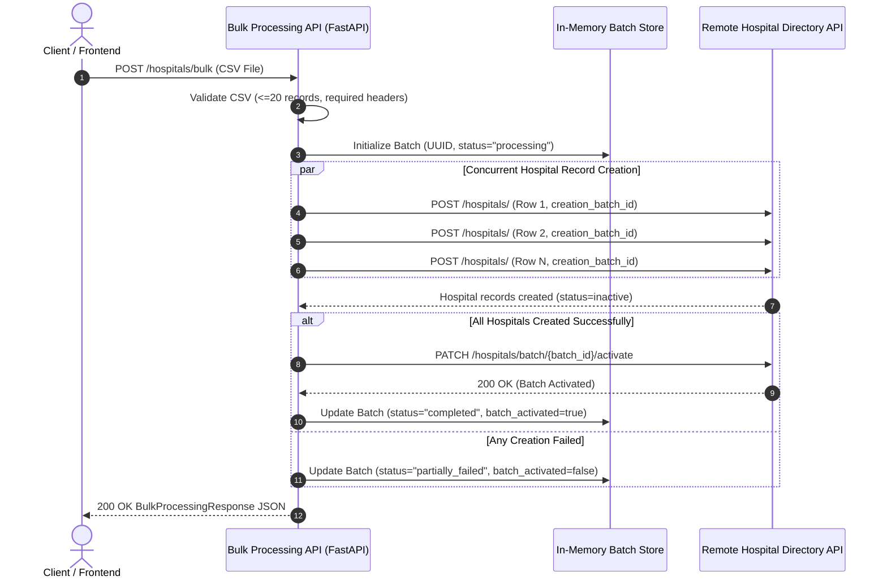

# Hospital Bulk Processing System

[](https://www.python.org/downloads/)
[](https://fastapi.tiangolo.com)
[](https://www.docker.com/)
[](https://opensource.org/licenses/MIT)

An enterprise-grade, high-performance Bulk Processing System that integrates with the external **Hospital Directory API** (`https://hospital-directory.onrender.com`). It validates CSV uploads, generates UUID-based batch jobs, executes concurrent record creations with throttled asynchronous I/O, activates batches atomically upon completion, and provides live status streaming via WebSockets and polling.

---

## Architecture & Processing Workflow

The system is designed around non-blocking asynchronous event loops and bounded concurrency to deliver sub-second bulk processing times for up to 20 hospital records per upload.



---

## Features Implemented

### 1. Core Requirements
- **Multipart CSV Upload:** `POST /hospitals/bulk` parses uploaded CSVs directly from memory without writing temporary files to disk.
- **Strict Validation:** Ensures presence of required columns (`name`, `address`), supports optional `phone`, and enforces the constraint of **maximum 20 hospitals** per CSV.
- **UUID Batch Generation:** Every batch is assigned a unique `uuid4` identifier.
- **Atomic Activation:** When all hospital records are created successfully, triggers `PATCH /hospitals/batch/{batch_id}/activate` on the Directory API.
- **Standardized Response:** Fully matches the schema required by the assignment specification.

### 2. Optional Tasks / Bonus Points Completed
- ** 6.1 Performance Optimization:** Built using `httpx.AsyncClient` with connection pooling and `asyncio.Semaphore` concurrency limiting. Requests are dispatched concurrently over persistent HTTP/2 keep-alive connections rather than sequentially blocking threads.
- ** 6.2 Progress Tracking:**
  - **Polling:** `GET /hospitals/bulk/{batch_id}/status` provides real-time progress percentages and row outcomes.
  - **Live WebSockets:** `/ws/batch/{batch_id}` streams instant JSON updates as each individual hospital record finishes processing.
- ** 6.3 Resume Capability:** `POST /hospitals/bulk/{batch_id}/resume` scans the batch record for failed items and re-attempts creation only for those rows, subsequently activating the batch once resolved.
- ** 6.4 CSV Validation Endpoint:** `POST /hospitals/bulk/validate` lets clients pre-flight validate CSV headers, syntax, and row limits before dispatching the actual creation.
- ** 6.5 Comprehensive Automated Testing:** Full test suite powered by `pytest` and `pytest-asyncio` covering happy paths, boundary conditions, partial failures, resume flows, and validation rules.

---

## API Specification

Interactive Swagger UI documentation is automatically available at:  
**`http://localhost:8000/docs`**

### Key Endpoints

| Method | Endpoint | Description |
| :--- | :--- | :--- |
| `POST` | `/hospitals/bulk` | Primary bulk CSV upload & processing endpoint |
| `POST` | `/hospitals/bulk/validate` | **(Bonus 6.4)** Pre-validate CSV structure and limit ($\le 20$) |
| `POST` | `/hospitals/bulk/{batch_id}/resume` | **(Bonus 6.3)** Retry failed records for an existing batch |
| `GET` | `/hospitals/bulk/{batch_id}/status` | **(Bonus 6.2)** Poll current progress & stats of a batch |
| `GET` | `/hospitals/bulk/batches` | List all tracked batches |
| `WS` | `/ws/batch/{batch_id}` | **(Bonus 6.2)** Real-time WebSocket stream for batch progress |
| `GET` | `/health` | Health check endpoint for deployment orchestration |

### Sample Response (`POST /hospitals/bulk`)

```json
{
  "batch_id": "8fa023e3-a4c8-472e-8302-3c1a3b3dc51f",
  "total_hospitals": 3,
  "processed_hospitals": 3,
  "failed_hospitals": 0,
  "processing_time_seconds": 0.452,
  "batch_activated": true,
  "hospitals": [
    {
      "row": 1,
      "hospital_id": 101,
      "name": "Mercy Hospital",
      "status": "created_and_activated",
      "error": null
    },
    {
      "row": 2,
      "hospital_id": 102,
      "name": "St. Luke Medical",
      "status": "created_and_activated",
      "error": null
    },
    {
      "row": 3,
      "hospital_id": 103,
      "name": "Community Health",
      "status": "created_and_activated",
      "error": null
    }
  ]
}
```

---

##  Local Development & Setup

### Prerequisites
* Python 3.10+
* Git
* (Optional) Docker & Docker Compose

### 1. Clone & Setup Virtual Environment
```bash
git clone <your-repository-url>
cd hospital-bulk-system

python -m venv .venv
# On Windows (PowerShell):
.\.venv\Scripts\Activate.ps1
# On Linux/macOS:
source .venv/bin/activate

pip install -r requirements.txt
```

### 2. Configure Environment Variables
Create a `.env` file (or rely on defaults):
```env
DIRECTORY_API_BASE_URL=https://hospital-directory.onrender.com
MAX_CSV_RECORDS=20
REQUEST_TIMEOUT_SECONDS=30.0
MAX_CONCURRENT_REQUESTS=10
```

### 3. Run the Development Server
```bash
uvicorn app.main:app --reload --host 0.0.0.0 --port 8000
```
Open **`http://localhost:8000/docs`** in your browser.

---

##  Running the Test Suite

Run the full automated test suite with coverage report:
```bash
pytest tests -v
```

Run specific test modules:
```bash
pytest tests/test_csv_validator.py -v
pytest tests/test_bulk_api.py -v
pytest tests/test_status_and_resume.py -v
```

---

## Docker & Containerization

### Run with Docker Compose
```bash
docker-compose up --build -d
```
The application will be live at `http://localhost:8000`.

### Check Logs & Health
```bash
docker-compose logs -f
curl http://localhost:8000/health
```

### Stop Containers
```bash
docker-compose down
```

---

##  Online Deployment Guide (Render)

This repository includes a native **`render.yaml`** blueprint for instant 1-click deployment:

1. Push your repository to **GitHub**.
2. Sign in to [Render](https://render.com).
3. Click **New +** > **Blueprint** (or **Web Service**).
4. Select your GitHub repository.
5. Render will automatically detect `render.yaml` or you can manually configure:
   - **Environment:** `Python 3`
   - **Build Command:** `pip install -r requirements.txt`
   - **Start Command:** `uvicorn app.main:app --host 0.0.0.0 --port $PORT`
6. Once deployed, Render will provide your public URL (e.g. `https://hospital-bulk-system.onrender.com`).

---

##  Project Directory Structure

```text
hospital-bulk-system/
├── app/
│   ├── __init__.py
│   ├── main.py                  # FastAPI app entrypoint, CORS, lifespan, exception handlers
│   ├── config.py                # Pydantic Settings & environment config
│   ├── models/
│   │   ├── __init__.py
│   │   ├── schemas.py           # Request/response schemas (Pydantic v2)
│   │   └── batch.py             # In-memory thread-safe batch job registry
│   ├── services/
│   │   ├── __init__.py
│   │   ├── directory_client.py  # Async HTTP client for Hospital Directory API (httpx)
│   │   ├── csv_validator.py     # CSV parsing, schema checking, <=20 row constraint
│   │   ├── bulk_processor.py    # Async bulk orchestrator & resume logic
│   │   └── progress_tracker.py  # Real-time WebSocket connection manager
│   ├── routers/
│   │   ├── __init__.py
│   │   ├── bulk.py              # POST /hospitals/bulk, /validate, /{id}/resume
│   │   ├── status.py            # GET /hospitals/bulk/{id}/status, /batches
│   │   └── websocket.py         # WebSocket /ws/batch/{id}
│   └── utils/
│       ├── __init__.py
│       └── logger.py            # Structured logging
├── tests/
│   ├── __init__.py
│   ├── conftest.py              # Pytest fixtures & directory mock client
│   ├── test_csv_validator.py    # CSV validator unit tests
│   ├── test_bulk_api.py         # Bulk creation & activation integration tests
│   ├── test_validation_api.py   # Bonus validation endpoint tests
│   ├── test_status_and_resume.py# Bonus status polling & resume tests
│   └── sample_csvs/             # Sample valid and invalid CSV test files
├── Dockerfile                   # Lean production Docker image
├── docker-compose.yml           # Multi-container local orchestration
├── render.yaml                  # One-click Render deployment configuration
├── requirements.txt             # Locked Python dependencies
├── .gitignore
├── .dockerignore
└── README.md                    # Project documentation
```
